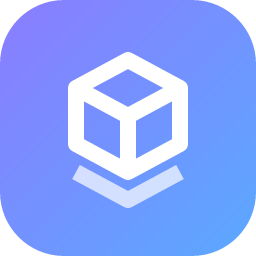

<p align="center">
  
</p>

<h1 align="center">Buildly</h1>

<p align="center">
  Your local dev dashboard: create, run and maintain all your projects, with Git, Docker, databases and the tools they need, in one app.
</p>

<p align="center">
  <strong>Version 0.3.3</strong> · released November 1, 2026 · Windows, macOS and Linux
</p>

## Download

| System | Download |
| --- | --- |
| **Windows** 10, 11 | [](https://github.com/B3nd4b0ss/Buildly_Release/releases/download/v0.3.3/Buildly_0.3.3_x64-setup.exe)<br><sub>or the [.msi package](https://github.com/B3nd4b0ss/Buildly_Release/releases/download/v0.3.3/Buildly_0.3.3_x64_en-US.msi)</sub> |
| **macOS** 11 or newer | [](https://github.com/B3nd4b0ss/Buildly_Release/releases/download/v0.3.3/Buildly_0.3.3_aarch64.dmg) [](https://github.com/B3nd4b0ss/Buildly_Release/releases/download/v0.3.3/Buildly_0.3.3_x64.dmg) |
| **Linux** | [](https://github.com/B3nd4b0ss/Buildly_Release/releases/download/v0.3.3/Buildly_0.3.3_amd64.AppImage) [](https://github.com/B3nd4b0ss/Buildly_Release/releases/download/v0.3.3/Buildly_0.3.3_amd64.deb) [](https://github.com/B3nd4b0ss/Buildly_Release/releases/download/v0.3.3/Buildly-0.3.3-1.x86_64.rpm) |

Buildly updates itself: new versions show up in the app, and one click installs them. Older versions and all files are on the [releases page](https://github.com/B3nd4b0ss/Buildly_Release/releases).

## What Buildly does

- **All your projects in one place.** Every folder in your workspace shows up with its stack (Spring Boot, React, Django, Go, .NET…), Git status and last change. Pin favorites, search and filter.
- **New projects in seconds.** About 27 templates: Spring Boot, Maven, Gradle, React, Vue, Svelte, Next.js, Angular, Express, NestJS, FastAPI, Flask, Django, ASP.NET Core, Go, Rust, PHP and more, with Git, a GitHub repository and a database if you like.
- **Run and watch.** Start dev servers, scripts and build tasks with live output and clickable local URLs. They keep running when you close Buildly and are back under your control when you open it again.
- **Git without the terminal.** Changes with diffs, commit and push, pull, branches, history, and new GitHub repositories.
- **Docker.** Containers with live CPU and memory, logs, shell, compose projects, images and volumes. Create containers from an image, a Dockerfile, a compose file or a script.
- **Databases.** PostgreSQL, MySQL, MariaDB, MongoDB and Redis in Docker or on your own database servers, plus SQLite: create them with a starter schema, browse tables, run queries, and connect them to a project (`.env`, driver and framework config included).
- **Your own database servers.** Connect the PostgreSQL, MySQL, MariaDB, MongoDB or Redis server you already have, on your computer or elsewhere, and Buildly creates new databases right inside it, each with a user of its own. No Docker needed.
- **Tools.** See which languages and tools are installed (Node.js, Python, Java, Maven, Gradle, Go, Rust, .NET, PHP, Git, Docker…) and install or update them with one click.
- **Logs.** Buildly keeps a log of what it does, so problems can be looked at afterwards.

Everything runs on your computer. Buildly only listens on `127.0.0.1` and keeps its settings in `~/.buildly`.

## What's new in 0.3.3

- **Run groups:** start a frontend, its backend and their database container with one click, and stop or restart them together. Make a group on a project's Run tab; each process in it shows whether it runs, and every command still runs on its own as before.
- **Port overview:** the new Ports tab on the Processes page shows which dev servers, databases and containers listen on which port and whose they are — a process Buildly started, a Docker container, or another program — and frees a port by stopping what holds it. The system's own services stay out of the way under "All".
- When a dev server can't start because its port is taken, its output now says what holds the port and offers to stop it and start again.
- **Command palette:** press Ctrl+K (⌘K on macOS) or the search button in the sidebar to jump to any project or page, run a script, start a run group, switch a branch or stop a process — all from the keyboard.
- **Full screen:** the desktop app now opens in full screen. Settings → Desktop app chooses whether it opens as a window, maximized or in full screen; F11 (⌃⌘F on macOS) turns full screen on and off at any time.
- **Your own shortcuts:** Settings → Command palette adds your own entries to the palette — any palette command under your name, a command run in a project, or a link — and key combinations like Ctrl+Alt+D that run them from anywhere in Buildly.
- **Live status:** projects and their Git status update by themselves when files change — edit, commit, switch a branch or pull in your editor or terminal and Buildly shows it within a second or two, without reloading.
- **Your own templates:** save any project as a template (its ⋯ menu or Settings tab) and start new projects as a copy of it — without dependencies, build output or .env files, and with the new project's name filled in. They show under "Your templates" when you create a project.
- **Dependencies:** a new page shows outdated packages and known vulnerabilities for all your projects at once — npm and pnpm, pip, Maven, Go and Cargo — with the fix for each advisory and one-click npm update / audit fix.
- **Database backups:** back up a database with one click and restore it later — PostgreSQL, MySQL, MariaDB and MongoDB in Docker (no tools to install), databases on your servers, and SQLite files.
- **CSV:** download any table as CSV, or add the rows of a CSV file to it.
- **Migrations:** the project's Database tab finds its migration commands — Prisma, Drizzle, Knex, Sequelize, Django, Alembic, Rails, Laravel, EF Core, Flyway, Liquibase or its own migrate scripts — and runs them.
- **WSL projects (Windows):** the folder picker lists your WSL distros, so projects inside WSL can be workspace folders. Their scripts, Git and dependency checks run inside the distro, VS Code opens them with Remote - WSL and the terminal opens in the distro.
- **Terminal in the project:** the new Terminal tab on a project opens a shell right in Buildly, in the project folder — your WSL distro (Ubuntu…), PowerShell, cmd or Git Bash on Windows, your login shell on macOS and Linux. A Windows project opens in WSL at its /mnt/c/… path. Open as many as you like; they keep running while you look at other pages and close when Buildly closes.
- **Dev containers:** projects with a devcontainer.json open in their container in VS Code, start it with one click, and can run all their commands inside it.
- **GitLab, Gitea and Bitbucket:** connect them in Settings → Git hosting (GitLab and Gitea also self-hosted, Codeberg too). Their projects get merge and pull requests in the Git tab — list, create, review, merge, close — tickets synced with their issues, and new repositories when you create or publish a project.
- **Deutsch:** Buildly speaks German. Settings → Appearance → Language chooses English, Deutsch or the system's language; dates follow your region.

## Installing

**Windows 10 or 11:** run the installer and accept the terms of use; no administrator rights needed. At the end it asks once whether Buildly may work without asking every time (a Windows Firewall rule for Buildly's Node.js, for which Windows asks for permission, and no confirmation before administrator actions); you can change this later in Settings. Windows may show "Windows protected your PC" because the app is not code-signed yet: click **More info → Run anyway**.

**macOS 11 or newer:** open the `.dmg` and drag Buildly into Applications. The app is not notarized yet, so the first start is blocked: right-click Buildly in Applications and choose **Open**, or run:

```bash
xattr -dr com.apple.quarantine /Applications/Buildly.app
```

**Linux:** the AppImage runs on most distributions and updates itself:

```bash
chmod +x Buildly_*.AppImage && ./Buildly_*.AppImage
```

Or install the package: `sudo apt install ./Buildly_*.deb` (Debian, Ubuntu) or `sudo dnf install ./Buildly-*.rpm` (Fedora). Packages are updated by installing the new version.

Buildly uses the tools already on your computer: Git, and Docker for containers and databases. Anything missing can be installed from its **Tools** page.
